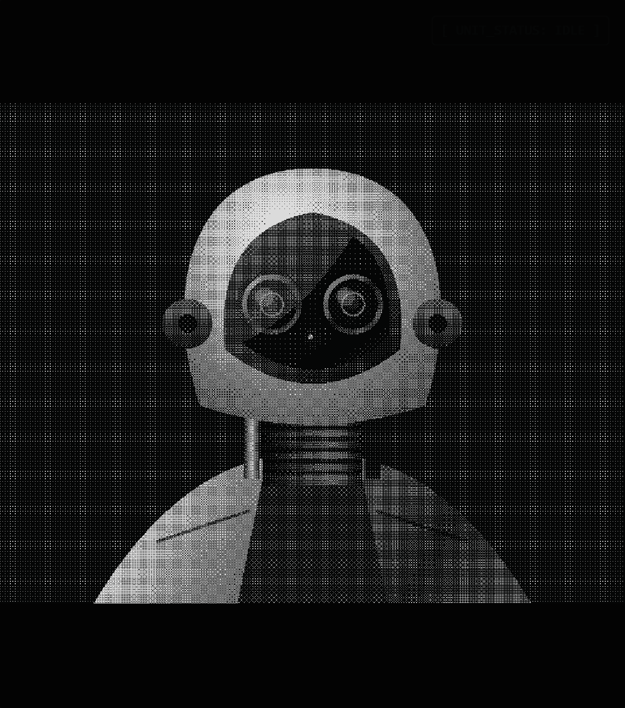

# `Yusen Xie`

I build AI agents and robotics systems, and explain the ideas behind them.

**Partner at [ZENO AI](https://zenobot.ai/)** · Head of Brand, Comms & Partnerships  
**Co-leader of [Z Lab](https://zlab.bot/)**

Student Researcher at CMU Robotics Institute. Previously co-founded Vector Robotics.

  <a href="https://yusenthebot.github.io/"> Portfolio</a> &nbsp;·&nbsp;
  <a href="https://yusenthebot.github.io/blog/"> Blog</a> &nbsp;·&nbsp;
  <a href="https://www.linkedin.com/in/yusenxie/"> LinkedIn</a> &nbsp;·&nbsp;
  <a href="https://x.com/YusenTheBot"> X</a> &nbsp;·&nbsp;
  <a href="mailto:yusenthebot@outlook.com"> Email</a>

  
   
  <a href="https://yusenthebot.github.io/"><code>Enter my world →</code></a>

## <picture></picture> `~/now`

**[ZENO AI](https://zenobot.ai/)** · Brand, Comms & Partnerships  
I lead brand, social media, communications and partnerships, including the design and development of [zenobot.ai](https://zenobot.ai/).

**[Z Lab](https://zlab.bot/)** · Experimental engineering  
I established Z Lab within ZENO AI to turn frontier technologies and unconventional ideas into working prototypes. The focus is engineering exploration, rather than academic publications or mass production.

## <picture></picture> `~/selected-work`

> ### [Vector OS Nano](https://github.com/VectorRobotics/vector-os-nano)
>
> An agent-orchestrated robot stack connecting natural-language goals with planning, perception, navigation and manipulation.
>
> <picture></picture> **Fully open-source software · Apache 2.0**  
> Previous work at Vector Robotics.

#### <picture></picture> Agent engineering

**[Robotics CTO](https://github.com/yusenthebot/robotics-cto)**  
A multi-agent engineering workflow for Claude Code: specifications, implementation, tests and review.

**[FlowLens](https://github.com/yusenthebot/flowlens)**  
Agent observability: traces, tool calls, cost tracking and failure analysis. [Try the dashboard →](https://yusenthebot.github.io/flowlens/demo_dashboard.html)

#### <picture></picture> Robotics experiments

**[MacMimic](https://github.com/yusenthebot/macmimic)**  
Whole-body motion tracking on Apple Silicon, evaluated in MuJoCo simulation.

**[FlyArm](https://github.com/yusenthebot/FlyArm)**  
A frozen fruit-fly connectome controls a simulated robot arm through trained input and output interfaces. [Explore the demo →](https://yusenthebot.github.io/FlyArm/)

[All repositories →](https://github.com/yusenthebot?tab=repositories) · [Project images and context →](https://yusenthebot.github.io/#more-work)

## <picture></picture> `~/explained`

I make Chinese-language explainers about AI and robotics, connecting research papers with diagrams, simulations and hands-on experiments.

<a href="https://x.com/YusenTheBot"> <strong>X / Twitter</strong></a> — `@YusenTheBot` 
<picture></picture> **[小红书 / Xiaohongshu](https://www.xiaohongshu.com/user/profile/634fb268000000001901c721)** — Yusenthebot  
<picture></picture> **抖音 / Douyin** — `@yusenthebot` · ID `59586023375`

[Browse diagrams and episodes →](https://yusenthebot.github.io/#creator)

<code>~/activity</code>

<picture>
  <source media="(prefers-color-scheme: dark)" srcset="https://raw.githubusercontent.com/yusenthebot/yusenthebot/output/github-snake-dark.svg" />
  <source media="(prefers-color-scheme: light)" srcset="https://raw.githubusercontent.com/yusenthebot/yusenthebot/output/github-snake.svg" />
  
</picture>

